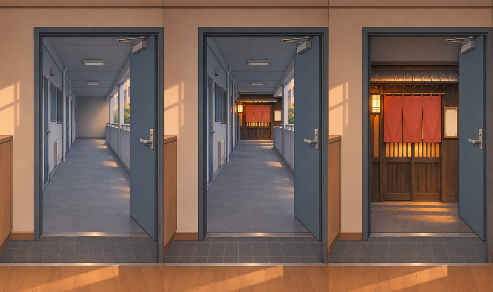

# EP001「『行けたら行く』が通じない日」背景・小物ラフ v1

**Draft／G2a前の色・構図検討。** Issue #3、担当は作画監督。参照 main `4f817874966a091fabc23c77d25a00cfe4f1aa58`。 [作画要求 #20](https://github.com/kouta1029/animation/pull/20) · [演出試作 #22](https://github.com/kouta1029/animation/pull/22) · [マスク試作 #21](https://github.com/kouta1029/animation/pull/21) · [脚本 v1.2 提出版](https://github.com/kouta1029/animation/blob/505632bf3fccc9ebcbab9adc400c0288bd9dc73a/episodes/ep001/script.md)

演出の後継 #24（`53c213b`）の依頼も照合した。背景3案は BG01/BG02（SH010・020・050・070の戸口）に対応し、小物は PR02〜PR04 の色・形の参考にできる。固定前景の分離、遠・中・近の連続性、開閉戸と把手の同期（PR01）、C画角での貼り紙と顔の同時視認は正式作画時の確認項目。#24 は台本 v1.1 が入力で、初画とL02の変更は v1.2 のG1判定後に演出と照合する。 [#24の作画依頼](https://github.com/kouta1029/animation/blob/53c213b3b64213ebc96da1307b97ad3df692c2aa/storyboards/ep001/art_requests.md)

## 背景と小物

- [通常廊下](genkan_normal.png) · [遠方の居酒屋](genkan_izakaya_far.png) · [接近した居酒屋](genkan_izakaya_near.png)。送信前の廊下 → のれんの出現と接近 → 断った後の廊下に対応する同一画角案。夕方の玄関に暖色、日常の廊下に青灰色、異変の目印に赤茶の三連のれんを置いた。
- [のれん](noren.png) · [貼り紙の台](notice_board.png) · [スマホ](smartphone.png)。単独の透過原稿。店名、S01、M01〜M06は別レイヤーで扱う。小物の透過は[明灰・青灰の比較画像](prop_alpha_comparison.png)を参照。
- [ラフ台帳](asset_manifest.csv)のパスはこのディレクトリ相対。支点は各PNG左上を原点とするピクセル座標の仮値。のれんは棒の中央、貼り紙は吊り位置、スマホは中心仮置き。手との接触位置と重なり、開閉戸の回転軸は正式画角・芝居に合わせて詰める。ラフIDは正式ショット台帳に登録しない。

## 作画QC

| 項目 | 判定 | 結果 |
| --- | --- | --- |
| 背景色と奥行きの読み分け | PASS（ラフ目視） | 原寸の3枚と、共通領域 x=82〜972、y=0〜1583 を Lanczos 縮小した360×640の比較を確認。通常廊下との色差で、のれんの出現と接近を識別できる。 |
| 固定部・遮蔽・貼り紙 | FAIL（実装採用） | 戸枠と戸の位置はほぼ揃うが、床・壁の光とタイル目地が微妙に変わる。静止ラフの画像切替では固定部がちらつく。近景でも貼り紙は画面幅360px時に約32px幅のため、演技用の寄りか文字の別表示をG2aで検討する。 |
| 小物の色・輪郭 | PASS（ラフ目視） | 幅320pxのタイルに3点を置き、明灰と青灰で透過の輪郭と布間の抜きを確認。のれんと貼り紙の独立素材を置くための無地の店背景、戸枠・開閉戸の独立レイヤーは未制作。 |
| オーナー基準・キャラ作画 | NOT_RUN | 原画像を現環境で取得できず、正式配役・デザイン一次承認待ち。表情・口・目・眉・手足・全身ポーズ、原寸/128px比較とキャラ再合成は未実施。 [総監督への報告](https://github.com/kouta1029/animation/pull/18#issuecomment-7074671528) |

## 技術QCと引き継ぎ

- Pillowの `Image.verify()` と再読み込みでPNG6点の寸法、背景のRGB、小物のRGBA・透明画素と非空画素を確認。比較画像はPNG書き出し後に目視。保管した画像6点はImageGen出力をそのまま収録。Godot合成・開閉・揺れの動作確認は **NOT_RUN**。
- 生成日 2026-11-22 JST。OpenAI ImageGenを使用。具体モデル版はツール出力に記載がない。背景ラフは脚本と作画要求を入力し、派生画像には表のラフ原画を実入力した。利用条件はOpenAIの出力の権利条項を確認。 [OpenAI Terms of Use](https://openai.com/policies/terms-of-use/)
- 総監督から基準画像・正式配役・デザイン一次承認、演出からG2aの正式画角・ショットIDが必要。演出と、台本v1.2の送信前に通常廊下が見える初画、戸の開閉幅、近景の貼り紙の読みを照合する。固定玄関、背景状態、戸枠・戸、のれん、貼り紙と文字を正式原画で分離し、映像監督と遮蔽・支点・動作を確認する。G2a・G2b・G2最終の承認待ち。
