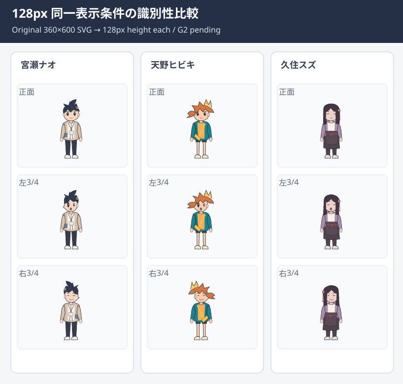

# 『もしも区の日常』メイン3人・独自性強化デザイン v0.3（G2審査用）

- 担当：作画監督
- 作成：2026-11-21
- 根拠：`docs/decisions.md` D-001〜D-007、`docs/character_design_parts_v0.1.md`
- 状態：**G2_PENDING（未承認・仮案）**
- 旧案：PR #6 の v0.2 正面リグ。今回のPRは後継であり、既存の表情・SVG/PNG生成基盤を継承する。

## 改訂の狙い
「どこにでもいる日本の若者」という初稿から、**小さな画面でも髪の輪郭と衣装小物で識別できるオリジナルのコメディキャラ**へ変更。シルエット（外形）→カラー→顔と手の演技の順で判断する。装飾は回転できる別レイヤーへ分離する。すべて仮案であり、世界観・人物像の正式承認を意味しない。

## キャラ別の変更点

| ID | シルエット（固有の輪郭） | 固有アイコン／衣装 | 主調色／役割 |
| --- | --- | --- | --- |
| `nao` 宮瀬ナオ | 1本だけ高く跳ねる非対称の前髪、少し縦長の輪郭 | 二本の明色ヘアピン、胸元の小さなIDカード、三角紋ワッペン。普段着と仕事の違和感を出す | ネイビーブラック＋ベージュ＋くすみ青。ツッコミ役 |
| `hibiki` 天野ヒビキ | 横に跳ねる大きな髪束、左右非対称な元気な輪郭 | 黄色の大きな二山リボン、斜めに走る配達バッグのストラップ、明るいパッチ | オレンジ＋ターコイズ＋黄色。行動担当 |
| `suzu` 久住スズ | 重いラインの切りっぱなしボブと端正な縦長輪郭 | 幾何学的な花飾り＋タッセル、落ち着いた色のエプロンとリボン。動かさない演技を強める | 濃い紫＋ラベンダー＋深紅。第三の視点／オチ担当 |

### 作画・リグ上の実装
- `tools/art/build_assets.py` を **v0.3ドラフト**に変更。
- `signature_hair`：髪／髪飾りの固有シルエット部品。
- `signature_costume`：衣装／小物の固有パーツ。
- 上記を従来の正面13層に追加し、**15層**。各キャラ **66 SVG + 66透過PNG**、3人合計 **198 SVG + 198 PNG**。
- 従来の目8状態・眉7状態・口10状態・表情10プリセットは維持。
- 配色は`CAST`・`asset_manifest.json`に記録。固定の共通キャンバス600×1600を使用し、PNGは750×2000に書き出す。
- 顔の通常状態や輪郭は**ラフ段階**。添付生成イメージとSVGリグは同一の完成絵ではない。実機で一致検証が必要。

## G2審査提出：設定画と128px比較（2026-11-21追加）

総監督レビュー [PR #8 コメント](https://github.com/kouta1029/animation/pull/8#issuecomment-7064435374) に対応する初期ラフ。**G2_PENDING、正式デザインではない**。キャラクターの名前・職業・性格は引き続き仮設定。

| キャラ | 正面・左3/4・右3/4のラフ | 確認対象 |
| --- | --- | --- |
| 宮瀬ナオ | [設定画SVG](../assets/concepts/v0.3/nao_turnaround.svg) | 高く跳ねた髪、二本ヘアピン、胸元ID、片眉・困惑 |
| 天野ヒビキ | [設定画SVG](../assets/concepts/v0.3/hibiki_turnaround.svg) | 左右に広がる髪・黄色飾り・肩掛け具、驚きと笑顔 |
| 久住スズ | [設定画SVG](../assets/concepts/v0.3/suzu_turnaround.svg) | 厚いボブ・花飾り・エプロン、控えめな目と口の演技 |

[128px比較SVGを単独表示](../assets/concepts/v0.3/compare_128px.svg)

### 比較条件と注意
- 元データは各**360×600の共通座標系**。128px比較では全キャラ・全向きに**128/600倍**を適用。画像を拡大して評価しない。
- 各キャラの服色、前髪、髪飾りを共通条件で比較できる。顔は正面と3/4で輪郭・目の位置／大きさを描き分けた試作。
- **右3/4は左3/4のミラー反転を使った仮ラフ**。髪留め、バッグ紐、アクセサリーの左右整合性を人体回転の完成検証としては扱わない。
- 「3.5〜4頭身」は目標値。飛び出た髪・リボンを頭部高さに含めるかで計測が変動するため、総監督承認前に体格比を定規付きモデルシートで最終固定する。
- 3/4は**静止設定画**。腕の関節回転、遮蔽、変形、感情の連続遷移、口パクなどのGodot実機検証ではない。
- 以前の高解像度コンセプト画像は**視覚的方向性の参考のみ**。ここで示すSVGラフをリグの完成形や画像の完全な再現と見なさない。

### G2デザイン一次審査の問い
1. 128pxで3人の識別が成り立つか（髪の外形／服の主色で判別できるか）。
2. 3/4向きで目・口・眉が読めるか（左右で配置崩れがないか）。
3. ナオの細身・ヒビキの横幅・スズの垂直ラインが役割を支えているか。
4. 非対称の小道具と肩掛け紐をどちらの肩・髪側に固定するか。

**レビュー状態：作画監督提出済み、総監督のデザイン一次審査待ち。G2最終承認ではない。**

## G2審査で見る点
1. 3人を各128px程度で表示して、髪型と服色で識別できるか。
2. 口パク・眉・瞳の交換時に髪飾りや袖が干渉しないか。
3. ナオの異常時ツッコミ、ヒビキの大げさな動作、スズの無動作の間を演じ分けられるか。
4. Shorts 9:16、長尺16:9の両方で頭部・衣装の余白とキャラクター間の身長比が崩れないか。
5. 既存作品・企業デザインと区別できるか（最終判定前に確認）。

## 未実施／承認前の制限
- **リグ化済みの左右3/4向き、腕6ポーズ、左右手5種、関節分割、歩行／走行、背景4点、PSDマスターは未制作。**
- Godot上でのリグ動作・遮蔽・口パク同期は未検証。自動QA合格はアート承認ではない。
- `docs/decisions.md`は変更しない。G2承認後、総監督の決定文書更新を別途要請。
- チャット内生成の高解像度コンセプト画像そのものはリポジトリへバイナリ添付できていないため、本PRに載る再生成可能なSVGラフとの厳密な絵柄一致は未保証。

## 他監督への引き継ぎ
- **総監督**：シルエット・色・装飾の採否をG2で判断。
- **演出監督**：EP001／EP002に必要な角度・ジェスチャー・表情の最小セットを確定。
- **映像監督**：v0.3素材（GitHub Actionsのartifact）からGodot組み込み、重なり／スケール／リップシンクを試験。
