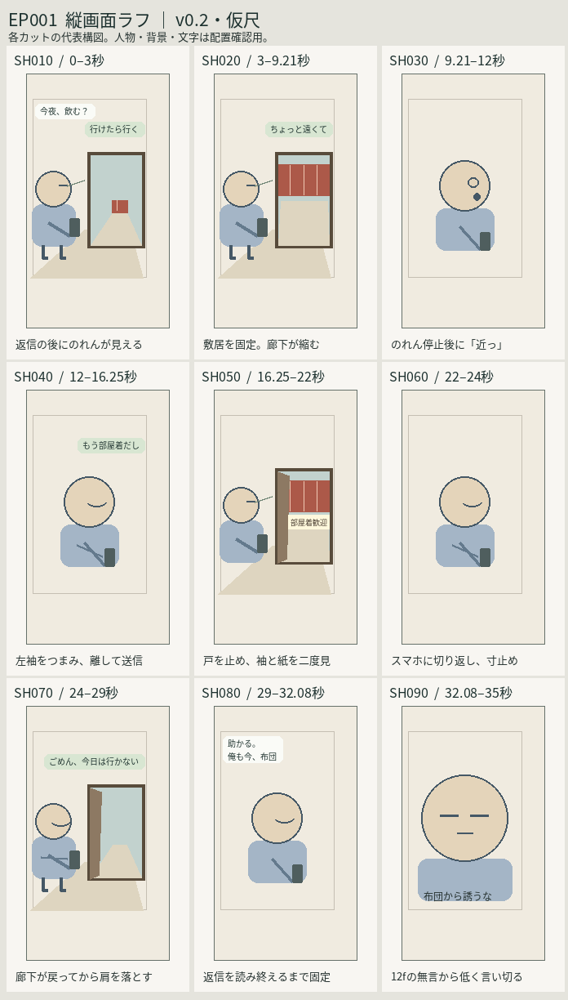

# EP001「『行けたら行く』が通じない日」絵コンテ v0.2

**G1前の演出準備稿。** G0承認済み。脚本v1.2のG1判定と候補音声の実測を受けて正式版を提出する。縦9:16、24fps、仮尺35秒。配役と店名は未決。

参照版は [G1提出脚本 v1.2（505632b）](../../episodes/ep001/script.md)、[演出試作 #22（47275c2）](https://github.com/kouta1029/animation/pull/22)、[作画要求 #20（769d271）](https://github.com/kouta1029/animation/pull/20)、[作画QC #19（6dc96c1）](https://github.com/kouta1029/animation/pull/19)、[技術試写 #21（90fc140）](https://github.com/kouta1029/animation/pull/21)、[後続の制作進行案 #23（fd3d766）](https://github.com/kouta1029/animation/pull/23)、[リミテッドアニメ方針 #12](https://github.com/kouta1029/animation/issues/4#issuecomment-7065090797)。mainの制作ルールは `4f817874966a091fabc23c77d25a00cfe4f1aa58`。

[カット台帳](../../episodes/ep001/shots.csv) ｜ [作画依頼](art_requests.md) ｜ [試写レビューと審査条件](review.md)

## 画面・演技の共通ルール

- 360×640換算で仮の安全域は x=16–300、y=64–512。Aの構図は主人公の肩と顔を左、戸口を右、スマホを左下寄りに置く。返信は上段2列以内、発話字幕は下段（暫定 y=454–502）。顔・手元・貼り紙は別の高さで読ませる。表示は1080×1920へ3倍。字幕とメッセージは16px相当以上、貼り紙は15px以上で試す。
- 廊下の床は玄関の敷居へ続く。戸、屋内壁、人物の足元、戸枠を固定したまま、敷居より奥だけ変える。カメラA↔B↔C↔Dは同じ側。Aは戸口・原因と結果、Bは反応と手元、Cは顔と貼り紙、Dは顔だけ。すべてカットで切り替える。
- 主人公は左手でスマホを保持。右手で左袖をつまみ、右親指で送信し、右手で戸を扱う。手を持ち替える前に接触を解く。両足は玄関マット上で接地し、のけぞりの重心移動だけ膝をわずかに緩める。幹事は文字のみ。
- 目が先に対象を捉え、必要な場面だけ肩・頭が遅れて動く。のれん停止後の驚きと、ツッコミ前の静止に動きの差を作る。短い送信タップと戸の音を候補とし、異変の説明音やオチを先取りする音楽キューは入れない。

## カット指示（0始まり、範囲終端は次カットの先頭）

表示時刻と台本の発話枠は仮。映像キューは最寄りのフレームに丸める。CSVのmsはフレーム境界から丸めて計算。隣のカットまで続くメッセージ表示は通しタイムラインで保持する（M04はSH050冒頭から17.00まで）。CSVの発話・画面文字IDは発火するカットに記載し、複数IDはセミコロン区切り。発話字幕は発話枠に沿い、M01–M06・S01には音声を付けない。

| ID末尾 / フレーム | 構図・カメラ | 芝居・間・音画キュー |
| --- | --- | --- |
| SH010 / 0–72 | **A 固定**。左に横顔・肩とスマホ、右にわずかに開いた戸口。誘いと普通の廊下を初画に入れる。上段に誘い、送信済みの返信は一段下。両方とのれんが同じ画で読めるようにする。 | 0.00 M01「今夜、飲む？」。0.90 M02「行けたら行く」送信（f22）。伏し目で右親指を一度押し、右手を把手へ。1.17から戸をもう少し開き、1.33（f32）を目安に通常廊下の奥へ店とのれんを出す。目が戸口へ移り、右の握り手が止まる。M01は2.40まで、M02とのれんは3.00まで。 |
| SH020 / 72–221 | **A 継続**。敷居と前景を同位置にして廊下の距離だけ変える。床の継ぎ目と奥壁も変わり、店入口が戸枠まで来る。 | 3.00–4.50 戸口→スマホ。右手を戸から離す。4.50 M03「ちょっと遠くて」送信、5.21–9.21（f125–221）で廊下が短縮。前半で距離変化を見せ、最後は短く減速して止める。目だけで追い、口は閉じたまま。M03表示は8.00まで。 |
| SH030 / 221–288 | **B 固定の胸上**。画面右外に戸口。スマホはフレーム下に残す。 | 9.21の停止で目を開き眉を上げる。約0.30秒遅れて、9.50から首と肩を引き、小声でL01「近っ」。右手は胸元で止め、足は踏み出さない。語尾で口を閉じ、スマホ、次いで自分の袖を見る。12.00までに肩を戻す。 |
| SH040 / 288–390 | **Bから手元へカット**。左袖の引っ張りとスマホを同じ画に入れる。 | 12.00–13.38 右の親指・人差し指で左袖をつまむ。袖へ伏し目、片眉だけ上げる。袖を離し14.00 M04「もう部屋着だし」送信。表示を保ち、右手を戸の把手へ回す。足は接地。 |
| SH050 / 390–528 | **C 固定**。顔を左、戸の縁と貼り紙を右。閉じかけで戸の端を残し、文字を塞がない。 | 16.25から戸を少し閉める。17.00 M04終了。戸の隙間に残った既存の貼り紙を、S01「部屋着歓迎」に差し替える。把手を握った右手が止まる。貼り紙を見る→18.50 袖を見る→19.25 貼り紙へ戻る。二度目は目だけ。閉口で眉を落とし、21.67から戸を少し戻す。文字は22.00まで保つ。 |
| SH060 / 528–576 | **B 固定**。胸上とスマホへ切り返す。貼り紙は画外。 | 22.00でスマホへ視線を落とし、右手を把手から離す。23.25から親指を画面の上で止める。小さく息を吐いて、送信直前は閉口の止め絵。 |
| SH070 / 576–696 | **Aに戻す**。冒頭と同じ戸枠位置。半開きの戸は手を離した角度で止め、貼り紙の掛かる面は戸の縁側に入れる。 | 24.00 M05「ごめん、今日は行かない」送信。24.08（f578）に開口内の店・のれん・紙を通常廊下へ切り替える。画面左の手足と戸の角度は切替の前後で同じ。目で廊下を確認し、24.50–25.00に肩が落ちる。M05は27.00まで。肩を落としたポーズのままスマホを待つ。 |
| SH080 / 696–770 | **B 固定の胸上**。スマホをフレーム下端、返信を上段、顔は中段。 | 29.00 M06「助かる。」と「俺も今、布団」を二行同時に出す。右手は動かさず、小さくのぞき込む。「助かる。」で目元が緩み、「布団」で視線が止まる。3.10秒相当の全文表示が切れるまで読んだ反応を保つ。 |
| SH090 / 770–840 | **D 固定の顔アップ**。スマホを画外、視線は画面下寄り。 | M06終了で切り、閉口のまま12f（0.50秒）。最初の6fでまぶたを半目へ一段だけ落とし、残り6fを保つ。f782を仮の開始とし、L02「布団から誘うな」を低く乾いた声で言い切る。首・腕は止め、「布団」の頭を小さく立て、「誘うな」を落として閉口。その顔のまま最低10fの余韻でカットアウト。 |

## 候補音声受領時の更新

| 発話 | 仮の発話窓 | 実測 | 受領後の合わせ方 |
| --- | --- | --- | --- |
| L01 | 9.50–10.40秒 | 未受領 | のれん停止と反射を先行させ、発話開始は9.50秒を基準。聞こえる語尾から閉口し、12.00秒までの余りを袖への視線移動に使う。反応枠まで圧迫する長さなら映像・脚本と再試聴して調整。 |
| L02 | f782–830（約2.00秒、机上見積もり1.50〜1.80秒） | 未受領 | 返信終了から12fの静止を試写。聞こえる語尾の次のフレームから10fの余韻を取り、35秒内で収まる場合は余韻を延ばす。35秒を超える場合は終端を更新し、総監督・脚本と協議する。 |

映像／音声担当から候補別のWAV、試聴リンク、素材版、収録全尺、先頭無音、発話開始・終了、語尾・息、末尾無音、発音と利用条件を受領する。発話開始を上表に合わせ、先頭無音を二重に加算しない。SH090の終端は、35秒と、「発話の開始時刻＋実発話長」をフレーム境界へ切り上げて余韻10fを加算した時刻のうち、遅い方を仮基準とする。音声を伸縮・切断して仮尺に合わせず、口形と字幕を実測に揃える。G3採用音声で演技または素材への影響が出た場合は該当カットのG2確認を依頼する。
